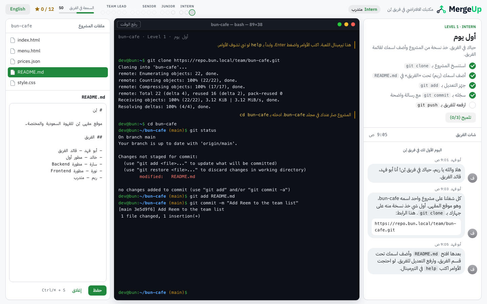

<div dir="rtl">

# Git Together

**تعلّم git مثل ما تستخدمه الفرق: وأنت داخل فريق.**
لعبة متصفح مجانية، بالعربي والإنجليزي.

### [▶ العبها في متصفحك](https://arkharashi.github.io/git-together/) · [English](README.md)



أنت موظف جديد في الفريق اللي يبني موقع «بُن»، مقهى سعودي للقهوة المختصة. قائد الفريق والزملاء شخصيات يتحكم فيها الكمبيوتر: يعطونك مهام، ويسألونك في شات الفريق، ويتفاعلون مع اللي تسويه. التيرمينال يشتغل مثل git الحقيقي، والغلط ينقص سمعتك بدل ما يوقف اللعبة.

مصممة للمبرمج اللي يشتغل لحاله: يعرف `add` و`commit` و`push`، بس ما جرب conflict مع زميل، ولا code review، ولا hotfix وهو في نص شغل.

## وش فيها

- **git حقيقي في المتصفح:** `clone` و`status` و`add` و`restore` و`reset` و`rm` و`commit` (مع `--amend`) و`log` و`show` و`diff` و`fetch` و`pull` و`push`، بنفس رسائل git. وفيه أوامر الشل الأساسية، والأسهم ترجّع أوامرك، و Tab يكمّلها.
- **فريق يتفاعل:** رسالة commit مبهمة، أو كلمة سر انرفعت، أو مهمتين في commit واحد، كلها لها أثر على سمعتك ونجومك، وقائد الفريق يعلّق.
- **تعليم مو بس تصحيح:** تلميحات تشرح كل غلط، وثلاث مستويات من المساعدة في كل مرحلة، و«رجّع الوقت» يعيد المستوى متى ما بغيت.
- **بالعربي أو بالإنجليزي:** كل نص موجود باللغتين، والواجهة تنقلب من اليمين لليسار حسب اللغة.
- **تصميم مرتب:** واجهة على طريقة أبل، وشات مثل iMessage، وتيرمينال يشبه Terminal في الماك، بألوان GitHub، بالوضع الفاتح والداكن.
- **على أي شاشة:** ثلاث أعمدة على الكمبيوتر، وعمودين على التابلت، وعمود واحد على الجوال، بالطول والعرض.
- **بدون حساب وبدون سيرفر:** كل شي في متصفحك، والتقدم محفوظ عندك.

الجاهز الحين: رتبة المتدرب كاملة (3 مستويات). خريطة كل المستويات (16 مستوى في 4 رتب لين مدير فريق) في [docs/design.md](docs/design.md).

## شغّلها عندك

تحتاج Node.js 22.12 أو أحدث.

```bash
npm install
npm run dev      # http://localhost:5173
npm run check    # فحص الأنواع والاختبارات
npm run e2e      # اختبارات المتصفح (أول مرة: npx playwright-core install chromium)
npm run build    # نسخة للنشر في dist/
```

## ساهم بمستوى

كل مستوى ملف واحد في `src/levels/`، وله حل مكتوب تختبره الاختبارات تلقائياً. التفاصيل في [CLAUDE.md](CLAUDE.md)، والسيناريوهات في [docs/design.md](docs/design.md).

## النشر

عند كل push على `main`، الـ workflow في `.github/workflows/deploy.yml` يبني اللعبة وينشرها على GitHub Pages.

## الرخصة

[MIT](LICENSE)

</div>
