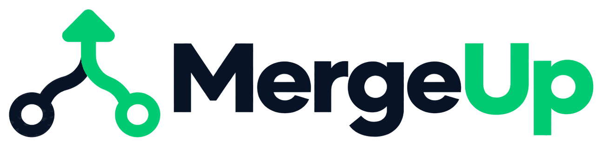

<div dir="rtl">

<div align="center">

<h1>
  <picture>
    <source media="(prefers-color-scheme: dark)" srcset="docs/brand/mergeup-dark.png">
    
  </picture>
</h1>

**تعلّم git مثل ما تستخدمه الفرق: وأنت داخل فريق.**

لعبة متصفح مجانية بالعربي والإنجليزي. أنت موظف جديد في فريق برمجة صغير: تاخذ مهامك من قائد الفريق، وتجاوب على أسئلته، وترفع شغلك من تيرمينال يشتغل مثل git الحقيقي.

### [▶ العبها الحين](https://arkharashi.github.io/mergeup/) &nbsp;·&nbsp; [English](README.md)

</div>


## ليش MergeUp

أغلب المبرمجين يتعلمون git لحالهم: `add` و`commit` و`push` وخلاص. الصعب يطلع لما تشتغل مع فريق: تقرأ تاريخ شغل غيرك، وتخلي الـ commits مرتبة تنفع للمراجعة، وما ترفع أسرار، وبعدها الفروع والـ conflicts ومراجعة الكود. MergeUp يحطك داخل هالفريق: تنضم للمبرمجين اللي يبنون موقع «بُن»، مقهى سعودي للقهوة المختصة، وكل غلط له أثر تتعلم منه بدل ما يوقف اللعبة.

## وش بتتعلم

| المستوى | الرتبة | وش تتدرب عليه |
| --- | --- | --- |
| 1 · أول يوم | متدرب | تستنسخ مشروع الفريق، وتعدّل ملف، وبعدها `add` و`commit` و`push`. رسالة الـ commit المبهمة تنقص سمعتك. |
| 2 · تاريخ المشروع | متدرب | تقرأ التاريخ بـ `git log` و`git show` عشان تجاوب على أسئلة قائد الفريق. |
| 3 · ترتيب الشغل | متدرب | تقسم ثلاث تعديلات على ثلاث commits، وتبعد ملف كلمة السر بـ `.gitignore`، وتتراجع عن commit بـ `git reset`. |
| 4–16 | من Junior لين مدير فريق | مصممة وجاية: الفروع، والـ conflicts، وطلبات الدمج ومراجعة الكود، وبعدها `stash` و`revert` و`cherry-pick` و`rebase`، وقيادة الفريق. |

## وش فيها

- **git حقيقي في المتصفح:** `clone` و`status` و`add` و`restore` و`reset` و`rm` و`commit` (مع `--amend`) و`log` و`show` و`diff` و`fetch` و`pull` و`push`، بنفس رسائل git. وفيه أوامر الشل الأساسية، والأسهم ترجّع أوامرك، و Tab يكمّلها.
- **فريق يتفاعل:** قائد الفريق يشرح ليش قبل كيف. رسالة commit مبهمة، أو كلمة سر انرفعت، أو مهمتين في commit واحد، كلها لها أثر على سمعتك ونجومك، وزملاء أكثر ينضمون في الرتب الجاية.
- **تعليم مو بس تصحيح:** تلميحات تشرح كل غلط، وثلاث مستويات من المساعدة في كل مرحلة، و«رجّع الوقت» يعيد المستوى متى ما بغيت.
- **بالعربي أو بالإنجليزي:** كل نص موجود باللغتين، والواجهة تنقلب من اليمين لليسار حسب اللغة.
- **تصميم مرتب:** واجهة على طريقة أبل، وشات مثل iMessage، وتيرمينال يشبه Terminal في الماك، بألوان GitHub، بالوضع الفاتح والداكن، على الجوال والتابلت والكمبيوتر.
- **بدون حساب وبدون سيرفر:** كل شي في متصفحك، والتقدم محفوظ عندك.

## شغّلها عندك

تحتاج Node.js 22.12 أو أحدث.

```bash
npm install
npm run dev      # http://localhost:5173
npm run check    # فحص الأنواع والاختبارات
npm run e2e      # اختبارات المتصفح (أول مرة: npx playwright-core install chromium)
npm run build    # نسخة للنشر في dist/
```

## الخطة الجاية

- [x] **متدرب** (المستويات 1–3): الاستنساخ والـ commit والرفع، وقراءة التاريخ، والـ commits المرتبة، و`.gitignore`.
- [ ] **Junior** (المستويات 4–6): الفروع و`switch` و`merge` مع الـ conflicts، وحماية `main`، وطلبات الدمج مع المراجعة والـ CI.
- [ ] **Senior** (المستويات 7–11): `stash` و`revert` و`cherry-pick` و`rebase` و`push --force-with-lease`، ومقاطعات وأنت في نص شغلك.
- [ ] **مدير فريق** (المستويات 12–16): مراجعة طلبات الزملاء، وترتيب الدمج، و`reflog`، وحماية الفروع، و`CODEOWNERS`، و`tag`.

تصميم كل المستويات بالتفصيل في [docs/design.md](docs/design.md).

## ساهم بمستوى

كل مستوى ملف واحد في `src/levels/`، وله حل مكتوب تختبره الاختبارات تلقائياً. الطريقة في [CONTRIBUTING.md](CONTRIBUTING.md)، والتفاصيل في [CLAUDE.md](CLAUDE.md).

## الرخصة

[MIT](LICENSE)

</div>
