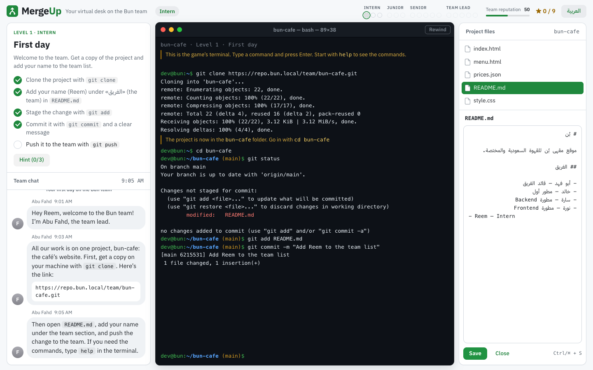
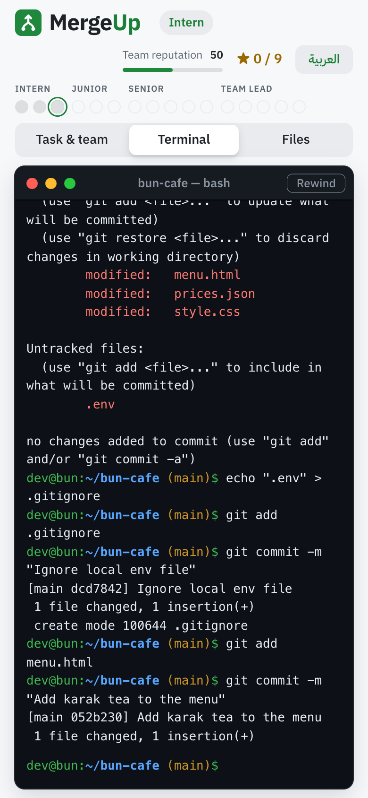
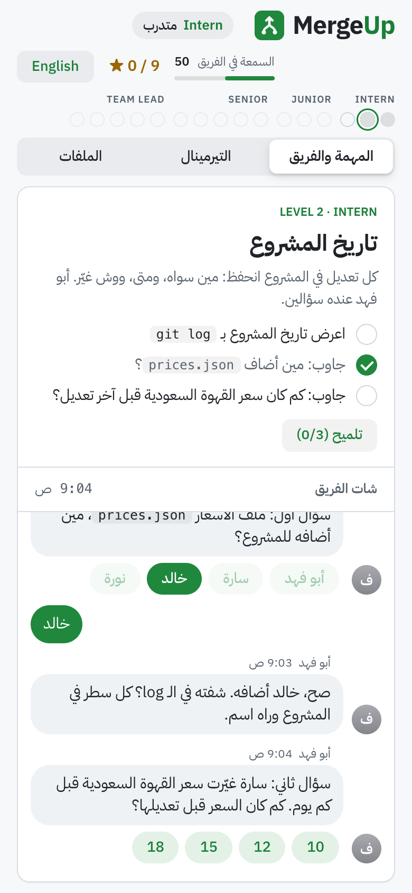
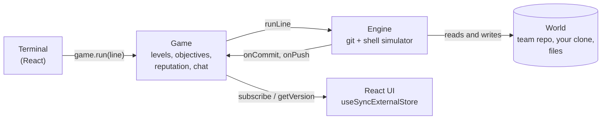

<div align="center">


# MergeUp

**Learn git the way teams use it: by joining one.**

A free browser game in English and Arabic. You're the new hire on a small dev team: take tasks from your team lead, answer their questions, and ship your work in a terminal that behaves like real git.

### [▶ Play now](https://arkharashi.github.io/mergeup/) &nbsp;·&nbsp; [اقرأ بالعربي](README.ar.md)

[](https://github.com/arKharashi/mergeup/actions/workflows/deploy.yml)
[](LICENSE)


</div>



## Why

Most developers learn git alone: `add`, `commit`, `push`, done. The hard parts only show up in a team: reading other people's history, keeping commits clean enough to review, not pushing secrets, and later branches, conflicts and code review. MergeUp puts you in that team. You join the developers behind Bun, a Saudi specialty coffee shop's website, and every mistake has a consequence you can learn from instead of ending the game.

## What you learn

| Level | Rank | You practise |
| --- | --- | --- |
| 1 · First day | Intern | Clone the team's repo, edit a file, then `add`, `commit` and `push`. A vague commit message costs reputation. |
| 2 · Project history | Intern | Read the history with `git log` and `git show` to answer your team lead's questions. |
| 3 · Tidy commits | Intern | Split three changes into three commits, keep a password file out with `.gitignore`, and undo a commit with `git reset`. |
| 4–16 | Junior → Team Lead | Designed, and next to build: branches, merge conflicts, pull requests and code review, then `stash`, `revert`, `cherry-pick`, `rebase`, and leading the team. |

## Features

- **Real git, in the browser.** `clone`, `status`, `add`, `restore`, `reset`, `rm`, `commit` (with `--amend`), `log`, `show`, `diff`, `fetch`, `pull` and `push` print the same messages as git itself. The shell has `cd`, `ls`, `cat`, `echo` with `>` and `>>`, `&&` chains, quotes, history and Tab completion.
- **A team that reacts.** Your team lead explains the why behind every rule. A vague commit message, a pushed password or two tasks in one commit all cost reputation and stars, and more teammates join in the later ranks.
- **Teaching, not just checking.** Coaching tips explain each mistake, every level has three tiers of hints, and you can rewind a level at any time.
- **English and Arabic.** Every line of copy exists in both, and the whole layout mirrors between left-to-right and right-to-left.
- **Designed with care.** An Apple-style layout with iMessage-style chat and a macOS Terminal window, in GitHub's colors, in light and dark mode, on phones, tablets and desktops.
- **No account, no server.** It's a static site, and your progress stays in your browser.

<p align="center">
  
  &nbsp;&nbsp;
  
</p>

## How it's built



| Part | What it does |
| --- | --- |
| **Engine** · `src/engine` | A git and shell simulator in plain TypeScript, with no DOM and no game rules. Commits form a graph with branches and a remote, a line diff (LCS) produces unified hunks, and a push is rejected when it isn't a fast-forward or targets a protected branch. It's deterministic, so tests can compare its output with real git's. |
| **Game** · `src/game`, `src/levels` | Each level is one TypeScript file: the starting repo, the team's chat script, objectives checked against the repo's state, three tiers of hints, hooks for consequences, and a scripted solution. |
| **UI** · `src/ui` | React 19 and Vite. The `Game` object is the single source of truth, read with `useSyncExternalStore`. The terminal renders a buffer that implements the engine's output interface. |
| **Two languages** | Player-facing text is typed as `{ ar, en }` from the engine to the UI, and CSS logical properties let one layout serve both directions. |

## Tests

- **68 unit tests** (Vitest). Git output is checked against what real git prints, every level's scripted solution must earn 3 stars, and everything the player reads must exist in both languages.
- **End-to-end tests** (Playwright) play the whole game like a player: every level and its traps, in both languages, on desktop and phones, in Chromium, WebKit and Firefox, and at 25 screen sizes.
- **CI** type-checks, tests and builds every push, and `main` deploys to GitHub Pages.

## Run it locally

You need Node.js 22.12 or newer.

```bash
npm install
npm run dev      # http://localhost:5173
npm run check    # type check and unit tests
npm run e2e      # browser tests (the first time: npx playwright-core install chromium)
npm run build    # the static site, in dist/
```

## Project structure

```
src/engine   git and shell simulator
src/game     game state, level types, ranks and the team
src/levels   one file per level, plus the coffee shop project's history
src/ui       React components
tests/       unit tests
e2e/         end-to-end tests
docs/        game design (Arabic) and screenshots
```

## Roadmap

- [x] **Intern** (levels 1–3): clone, commit, push, reading history, clean commits, `.gitignore`.
- [ ] **Junior** (levels 4–6): branches, `switch`, `merge` with conflicts, a protected `main`, pull requests with review and CI.
- [ ] **Senior** (levels 7–11): `stash`, `revert`, `cherry-pick`, `rebase`, `push --force-with-lease`, interruptions mid-task.
- [ ] **Team Lead** (levels 12–16): reviewing teammates' pull requests, merge order, `reflog`, branch protection, `CODEOWNERS`, `tag`.

The full design of every level is in [docs/design.md](docs/design.md) (in Arabic).

## Contributing

Levels are one file each, with a scripted solution that the tests play. [CONTRIBUTING.md](CONTRIBUTING.md) explains how to add one.

## License

[MIT](LICENSE) © Abdulrahman Alkharashi
